# Serveur de flux (zoneclearFeedServer) : guide d'utilisation

Ce guide explique comment mélanger votre blog Dotclear avec un « planet » : l'extension zoneclearFeedServer lit les flux de syndication d'autres sites et les republie sous forme de billets sur votre blog.

## Sommaire

1. [Configurer l'extension](#configurer-lextension)
2. [Ajouter une source](#ajouter-une-source)
3. [Mettre à jour les flux](#mettre-à-jour-les-flux)
4. [Gérer la liste des flux](#gérer-la-liste-des-flux)
5. [Les billets importés](#les-billets-importés)
6. [Afficher les sources sur le site](#afficher-les-sources-sur-le-site)
7. [Favori et préférences](#favori-et-préférences)

## Configurer l'extension

Depuis **Plugins**, ouvrez l'extension puis cliquez sur **Configurer le plugin** (ce lien est aussi en bas de chaque page de l'extension). Il faut être super administrateur.

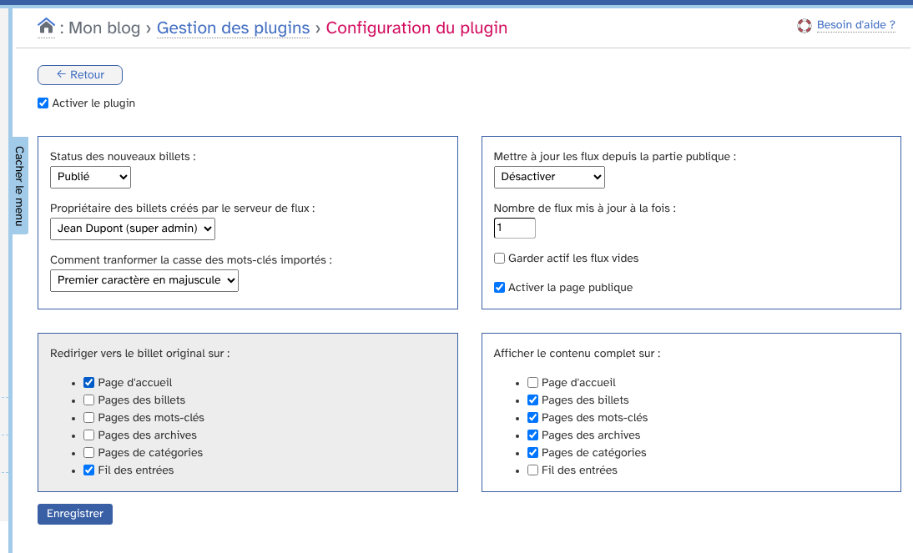

* **Activer le plugin** : tant que la case n'est pas cochée, rien n'est importé.
* **Status des nouveaux billets** : « Non publié » (vous validez à la main) ou « Publié ».
* **Propriétaire des billets créés par le serveur de flux** : l'utilisateur auquel sont rattachés les billets importés.
* **Comment tranformer la casse des mots-clés importés** : garder la casse de la source, premier caractère en majuscule, tout en minuscule ou tout en majuscule.
* **Mettre à jour les flux depuis la partie publique** : *Désactiver*, *Avant l'affichage*, *Après l'affichage* ou *À travers Ajax*. Avec Ajax, le thème doit appeler le behavior `publicHeadContent`.
* **Nombre de flux mis à jour à la fois** : laissez 1, une valeur élevée peut dépasser le temps d'exécution du serveur.
* **Garder actif les flux vides** : sinon un flux qui ne renvoie rien est désactivé.
* **Activer la page publique** : affiche la liste des sources sur le site.
* **Rediriger vers le billet original sur** : sur les pages cochées, le titre d'un billet importé mène au billet du site d'origine.
* **Afficher le contenu complet sur** : sur les pages cochées, le billet importé est affiché en entier plutôt que son début.

Un dossier de cache de Dotclear accessible en écriture est nécessaire. Cliquez sur **Enregistrer**.

## Ajouter une source

Dans le menu **Plugins › Serveur de flux**, cliquez sur **Nouveau flux**.

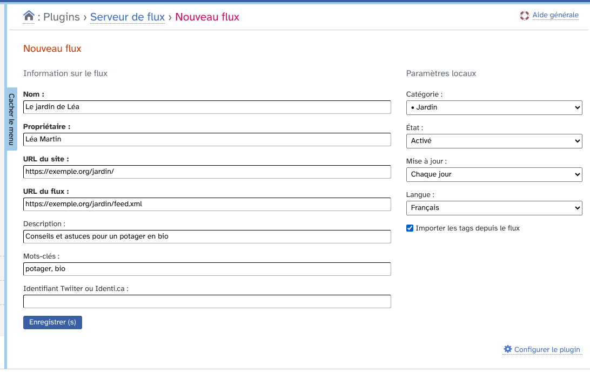

Les champs en gras sont obligatoires.

* **Nom** de la source, **Propriétaire** (l'auteur affiché pour les billets de ce flux), **URL du site** et **URL du flux**.
* **Description** de la source (affichée sur la page publique des sources) et **Mots-clés** (ajoutés aux billets importés).
* **Identifiant Twiiter ou Identi.ca** : facultatif.
* **Catégorie** : la catégorie de votre blog qui reçoit les billets.
* **État** : « Activé » ou « Désactivé » (un flux désactivé n'est pas mis à jour automatiquement).
* **Mise à jour** : toutes les heures, toutes les deux heures, deux fois par jour, chaque jour, tous les deux jours ou chaque semaine.
* **Langue** de la source.
* **Importer les tags depuis le flux** : reprend les catégories du flux comme mots-clés.

Cliquez sur **Enregistrer**. Une URL de flux déjà enregistrée est refusée.

## Mettre à jour les flux

Une mise à jour lit le flux et crée un billet pour chaque nouvelle entrée. Elle peut se faire de deux façons.

* **À la demande** : dans la liste des flux, cochez les flux puis choisissez l'action **Mettre à jour (vérifier) le flux**. La mise à jour est forcée, même pour un flux désactivé.
* **Depuis la partie publique** : selon le réglage de la configuration, la visite d'une page du site déclenche la mise à jour des flux dont la périodicité est dépassée.

## Gérer la liste des flux

La page **Plugins › Serveur de flux** liste les flux avec leur périodicité, leur dernière mise à jour, leur nombre d'entrées et leur état.

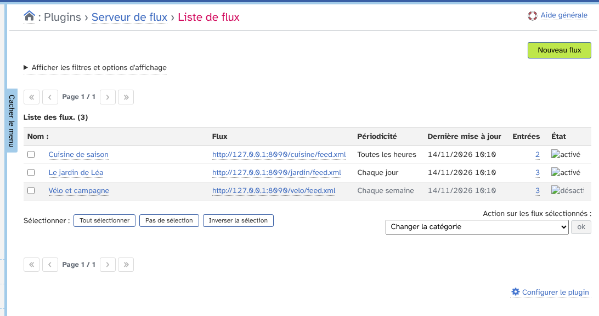

Un flux désactivé est grisé. Le nombre d'entrées mène aux billets du flux, le nom mène à sa modification.

### Filtres

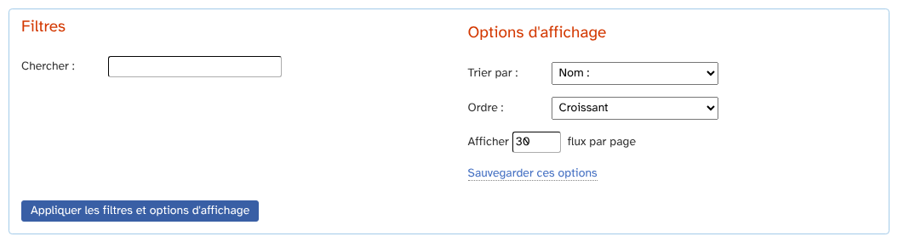

Le bloc de filtres permet de chercher un flux et de régler le tri (nom, dernière mise à jour, date de création), l'ordre et le nombre de flux par page.

### Actions sur les flux sélectionnés

Cochez des flux, choisissez une action puis cliquez sur **ok**.

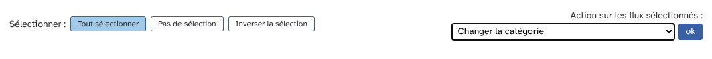

* **Changer la catégorie** et **Changer l'interval de mise à jour**.
* **Désactiver** ou **Activer la mise à jour du flux**.
* **Remettre à zéro le chronomètre de mise à jour** : le flux sera relu à la prochaine occasion.
* **Mettre à jour (vérifier) le flux**.
* **Effacer les billets liés** : supprime les billets importés, le flux est conservé.
* **Effacer le flux (sans effacer les billets liés)**.

## Les billets importés

Cliquez sur le nom d'un flux pour le modifier.

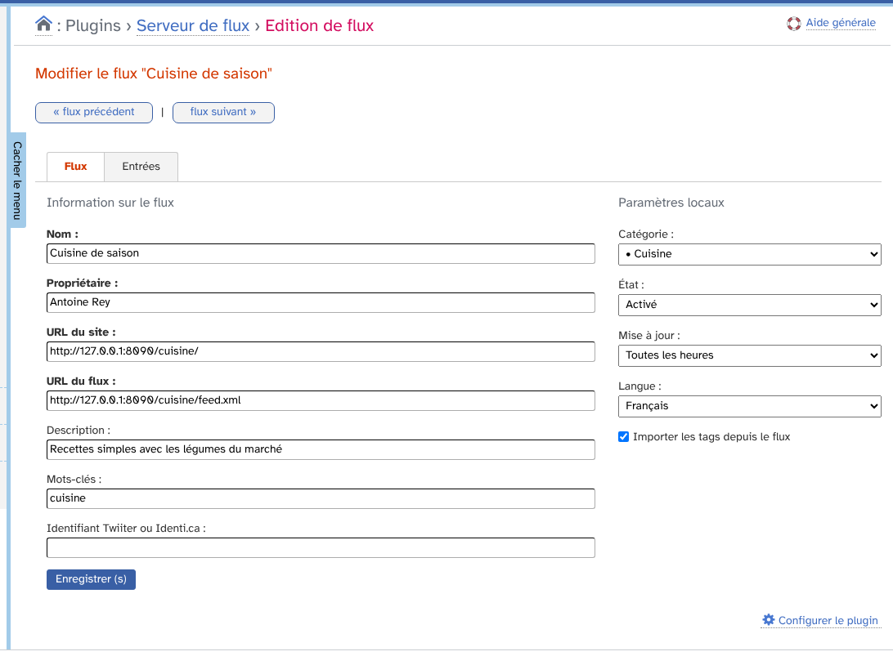

Les boutons **flux précédent** et **flux suivant** passent d'un flux à l'autre. L'onglet **Entrées** liste les billets importés.

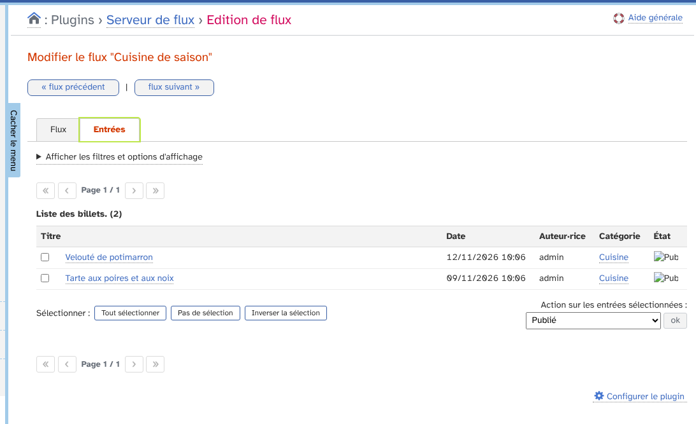

Cette liste a ses propres filtres (état, mois, auteur, catégorie, tri) et ses actions : publier, dépublier, sélectionner, changer la catégorie, la langue ou l'auteur, ajouter ou retirer des mots-clés, supprimer.

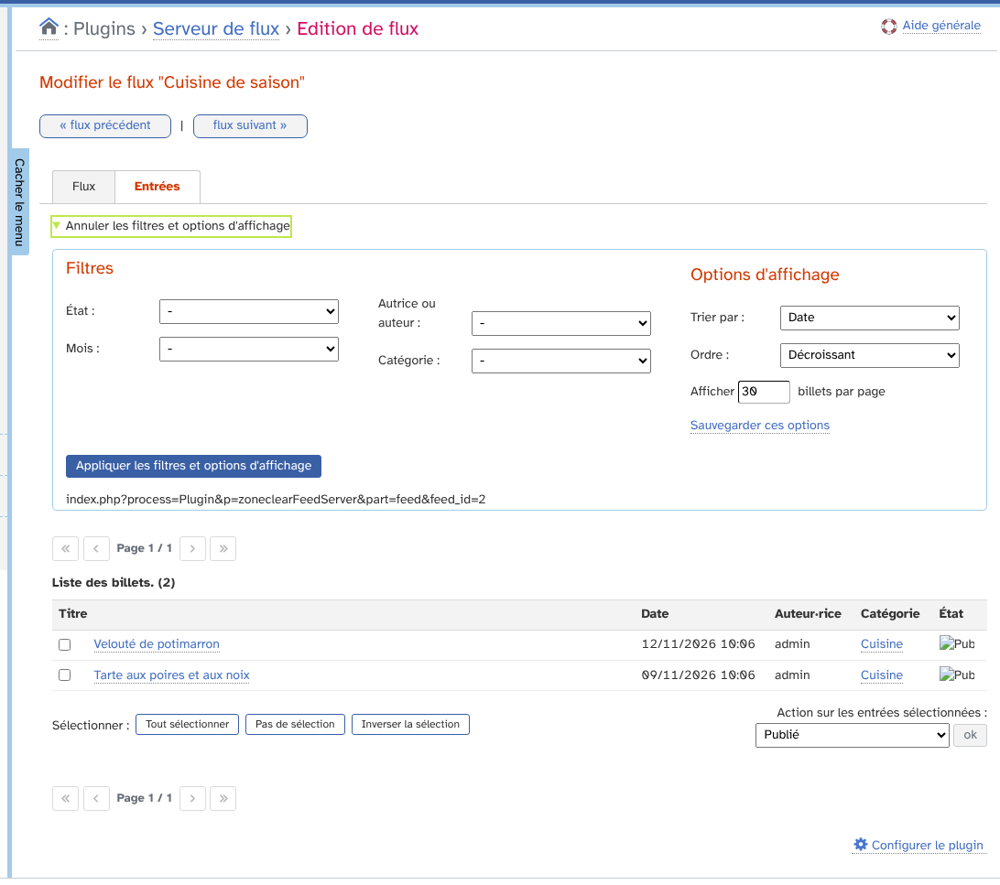

Les billets importés sont aussi dans la liste des billets du blog, avec une colonne « Serveur de flux ».

Sur le site, un billet importé montre l'auteur du flux, la source, la catégorie et les mots-clés.

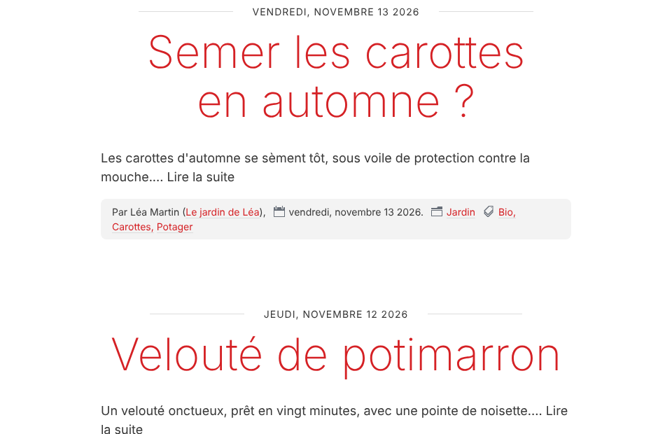

Selon les réglages, le titre mène au billet d'origine. Sur la page du billet, une ligne « Billet original sur » renvoie à la source.

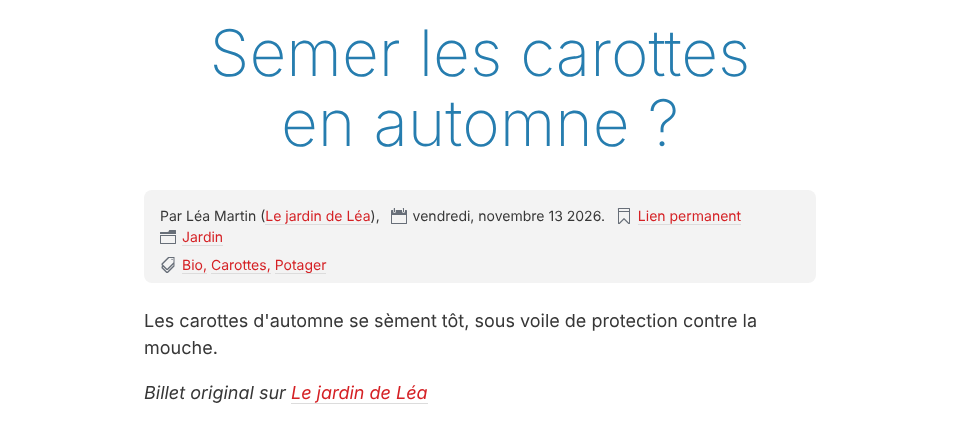

## Afficher les sources sur le site

### Page publique des sources

Si la page publique est activée, la liste des sources est disponible à l'adresse `/zcfeeds` de votre blog. Seuls les flux activés y figurent.

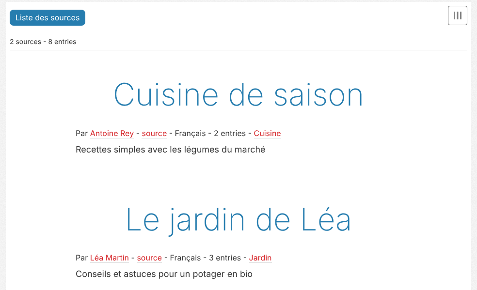

### Widgets

Deux widgets sont disponibles dans **Apparence du blog › Widgets**.

* **Serveur de flux : les sources** : la liste des sources, avec le tri, l'ordre, une limite et un lien vers la page publique.

  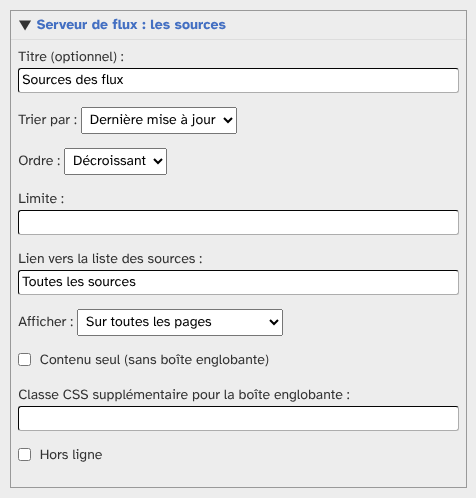

* **Serveur de flux : les chiffres** : le nombre de flux et le nombre de billets importés.

  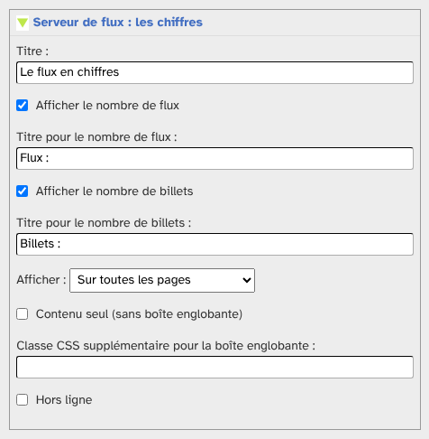

Voici le rendu sur le site.

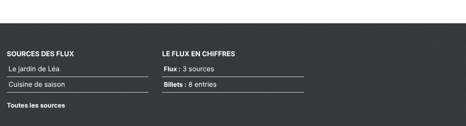

## Favori et préférences

Dans **Préférences › Mon tableau de bord**, ajoutez **Serveur de flux** à vos favoris. L'icône du tableau de bord indique le nombre de flux désactivés.

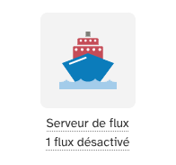

Dans **Préférences › Mes options**, vous choisissez les colonnes affichées dans les listes « Serveur de flux : Flux » et « Serveur de flux : Billets », ainsi que le tri et le nombre d'éléments par page.

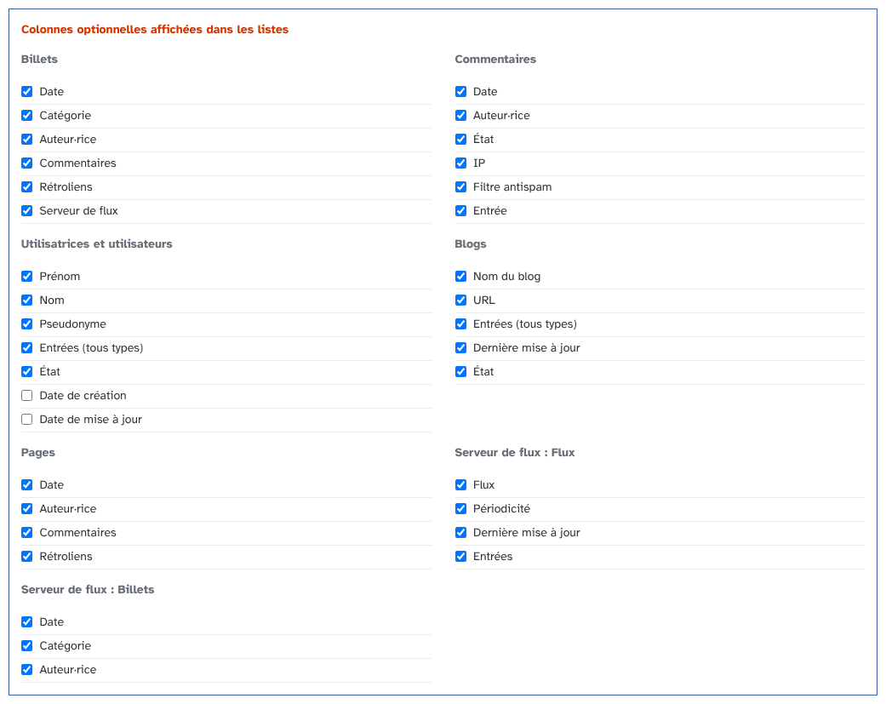
